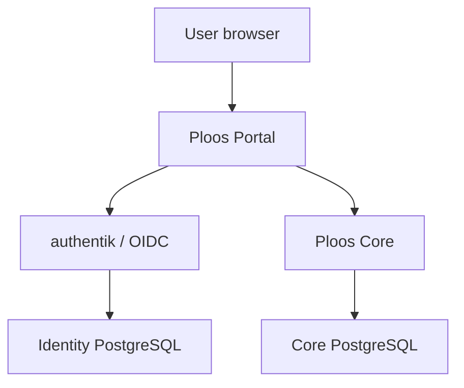

# Identity architecture and responsibility boundaries

## Decision

Use **self-hosted authentik** for interactive identity, rather than developing login software. This is a provider decision, not approval to deploy, expose a public endpoint, or select a host.

- authentik owns user credentials, MFA, passkeys, recovery, OIDC token issuance and revocation.
- Portal owns server-side login callback, session cookies, anti-CSRF, refresh and logout. OAuth access/refresh tokens must never enter browser-readable storage.
- Core owns organizations, roles, memberships, subscriptions, product and provisioning authorization. Authentication alone must not grant tenant access.
- No direct browser-to-Core access, no use of the identity provider as a subscription database, and no direct provisioning access from browser code.
- Identity subject keys must be stable and namespaced by issuer; avoid using email as the primary identifier.
- Forenio's public anonymous formation wizard remains independent of authentication.

## OAuth / OIDC policy

- Use Authorization Code with PKCE S256, `state`, `nonce`, an exact allowlist of redirect URLs and a confidential Portal client when server-to-server token exchange is used.
- Dedicated beta and production applications, clients, keys, databases, secrets and hostnames. Do not share live sessions across environments.
- Require signed ID tokens and verify issuer, signature, audience, expiration, nonce, state and clock skew.
- Verify exact Core-compatible access-token validation: audience/scopes/subject, introspection credentials or JWT/JWKS strategy. No assumption that an ID token is valid for Core.
- authentik's global introspection endpoint enforces provider-scoped access; cross-provider introspection requires explicit federation configuration. Confirm the intended Core/Portal provider topology in an integration test.
- All application permissions are checked again by Core, against its own organization membership data.

## Accounts and onboarding

- Self-registration **disabled initially**. Enable only after invitation/verification, bot-abuse controls, email delivery and tenant-linking semantics have been reviewed.
- Require phishing-resistant MFA where practical, at least MFA for operators/admins, safe account recovery and audited break-glass access.
- Avoid any automatic organization creation when an external identity signs in.
- Confirm the five-seat baseline for ordinary group plans is a **billing/product** concern, never an auth restriction.

## Source of truth

The existing Core roadmap remains authoritative for product and API work. Any disagreement in claim formats, token validation or organization authorization blocks live integration.
